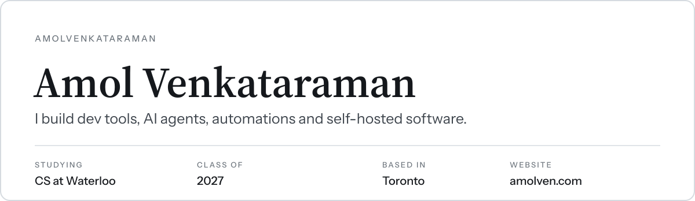

[amolven.com](https://amolven.com) · [X](https://x.com/amolven16) · [LinkedIn](https://www.linkedin.com/in/amolven16)

**Now:** final year of CS at Waterloo · open to new-grad roles for 2027 
**Prev:** Assort Health (AI SWE) · Federato (FDE) · goConfirm · ApplyBoard · Travelers · RBC · Nokia 
**Also:** founder and president, UW Code Lab · VP, UW Computer Science Club

